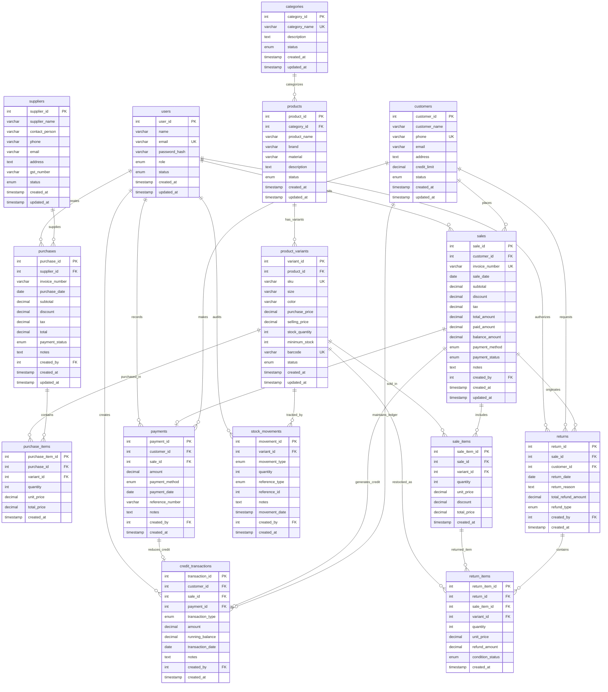

# Entity-Relationship Diagram
## VL Silks - Database Entity-Relationship Reference (15 Tables)
---
## 1. Mermaid ER Diagram

---
## 2. Table Relationships & Cardinality
| Parent Table | Child Table | Foreign Key | Cardinality | Delete Action | Business Meaning |
|---|---|---|---|---|---|
| `categories` | `products` | `category_id` | 1 : N | RESTRICT | Categories cannot be deleted while products belong to them |
| `products` | `product_variants` | `product_id` | 1 : N | RESTRICT | Products cannot be deleted while variants exist |
| `suppliers` | `purchases` | `supplier_id` | 1 : N | RESTRICT | Suppliers with purchase records are retained for accounting |
| `purchases` | `purchase_items` | `purchase_id` | 1 : N | CASCADE | Deleting a purchase deletes all its line items |
| `product_variants` | `purchase_items` | `variant_id` | 1 : N | RESTRICT | Variants with purchase history cannot be dropped |
| `customers` | `sales` | `customer_id` | 1 : N | SET NULL | Walk-in sales have NULL customer; customer deactivation preserves sales |
| `sales` | `sale_items` | `sale_id` | 1 : N | CASCADE | Deleting a sale cascades to its line items |
| `product_variants` | `sale_items` | `variant_id` | 1 : N | RESTRICT | Variants with sales history are protected |
| `customers` | `payments` | `customer_id` | 1 : N | RESTRICT | Customers with payment records cannot be deleted |
| `sales` | `payments` | `sale_id` | 1 : N | SET NULL | Payments linked to sales persist even if sale is decoupled |
| `customers` | `credit_transactions`| `customer_id` | 1 : N | RESTRICT | Credit ledger history must be permanently preserved |
| `sales` | `credit_transactions`| `sale_id` | 1 : N | SET NULL | Credit debits link to sales |
| `payments` | `credit_transactions`| `payment_id` | 1 : N | SET NULL | Credit credits link to settlement payments |
| `product_variants` | `stock_movements` | `variant_id` | 1 : N | RESTRICT | Complete audit history is preserved |
| `sales` | `returns` | `sale_id` | 1 : N | RESTRICT | Returns must link to a valid historical sale |
| `customers` | `returns` | `customer_id` | 1 : N | SET NULL | Returns retain customer association |
| `returns` | `return_items` | `return_id` | 1 : N | CASCADE | Return items cascade with the return header |
| `sale_items` | `return_items` | `sale_item_id` | 1 : N | SET NULL | Links returned line to original billed line item |
| `product_variants` | `return_items` | `variant_id` | 1 : N | RESTRICT | Preserves variant link for restocking/damage |
| `users` | `*` (6 tables) | `created_by` | 1 : N | RESTRICT | Full audit trail of which user performed each transaction |
